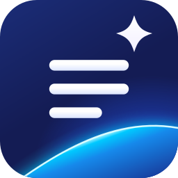
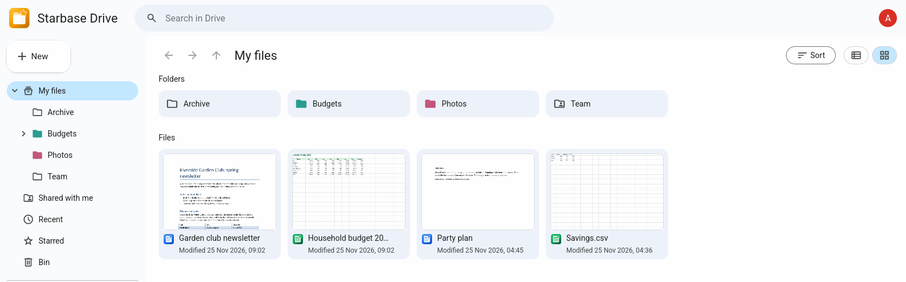
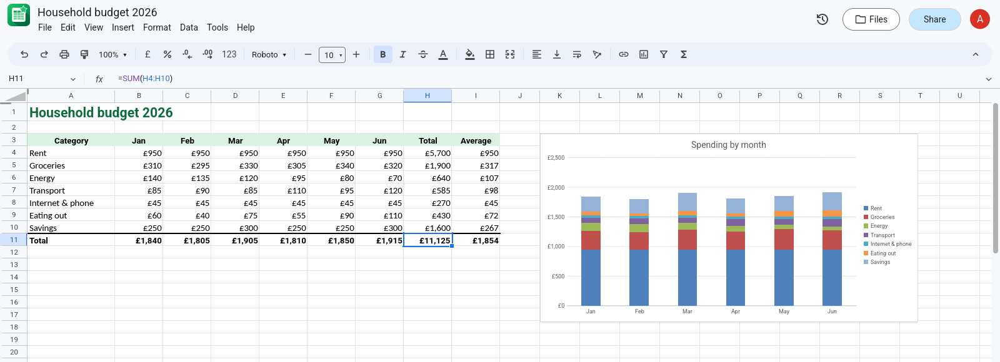
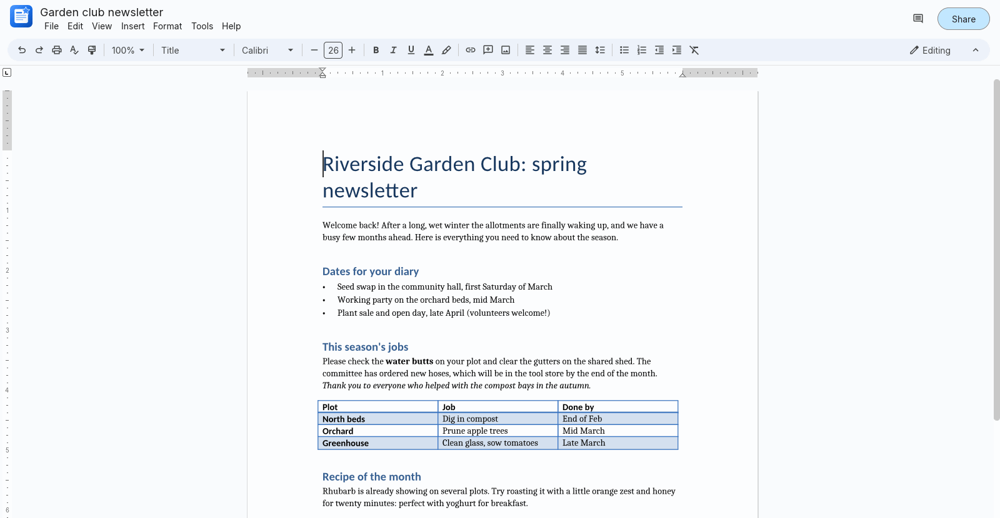

<p align="center">
  &nbsp;&nbsp;
  &nbsp;&nbsp;
  &nbsp;&nbsp;
  
</p>

<h1 align="center">Starbase</h1>

<p align="center">
  <b>A self-hosted, open-source alternative to Google Workspace.</b><br>
  Drive, Sheets, Docs and (brand new) Slides, with your files kept as ordinary <code>.xlsx</code>,
  <code>.docx</code> and <code>.pptx</code> on your own disk.
</p>

<p align="center">
  <a href="https://github.com/DomeShifter/Starbase/releases/latest"></a>
  <a href="https://github.com/DomeShifter/Starbase/actions/workflows/starsheets.yml"></a>
  <a href="#licence"></a>
</p>

> [!NOTE]
> **Early preview (v0.2.0).** Starbase works and we use it every day, but it is young: expect
> rough edges, keep your own backups (the built-in backups help), and please
> [tell us what breaks](https://github.com/DomeShifter/Starbase/issues). Starbase Sheets is the
> most mature part; Starbase Docs and Starbase Drive are newer, and Starbase Slides has only just
> arrived.

<p align="center">
  
</p>

## Why Starbase

Google Workspace is wonderfully convenient, until you want your files back, want to work offline,
or would rather not hand everything to someone else's servers. Starbase aims for the same
friendly, familiar feel, on a machine you control.

| | |
|---|---|
| **Your files stay yours** | Every spreadsheet is a real `.xlsx`, every document a real `.docx` and every presentation a real `.pptx`, in a normal folder. Open them in Excel, Word, PowerPoint or LibreOffice any time. No database to export from, no lock-in. |
| **Any disk, any server** | One Docker image runs the whole suite on a home server, a NAS (TrueNAS, Unraid), a Proxmox box or a small cloud machine. |
| **Work together** | Live co-editing in Starbase Sheets: several people in the same spreadsheet, seeing each other's changes as they happen. |
| **Share like you're used to** | Share files and folders with people as editor or viewer, or by link. |
| **Version history** | Go back to any earlier version, name the important ones, restore without losing anything. |
| **Backups built in** | Scheduled, encrypted backups (restic format) with restore from the app. |
| **Sign in your way** | Starbase's own accounts, or single sign-on through your own login service (OIDC: Authelia, Authentik, Keycloak and others). |
| **Desktop too (in progress)** | Native Linux programs that work offline on local files, or connect to your Starbase server. |

## What works today

Starbase **v0.1.0** (November 2026) is the first public release, and `main` has moved on since.
In one image you get:

**Starbase Drive**, the home screen: folders (with colours), file previews, search, recent,
starred, shared with me and a bin.

**Starbase Sheets**, a spreadsheet that feels like Google Sheets: Sheets-style menus, toolbar and
keyboard shortcuts, formulas, charts, conditional formatting, drop-downs (including multiple
selections and chips), filters and filter views, comments, and live editing with other people.

<p align="center">
  
</p>

**Starbase Docs**, a word processor that feels like Google Docs: paragraph styles, lists, tables,
pictures (with crop and text wrapping), comments, version history and your own default styles.

<p align="center">
  
</p>

**Starbase Slides** (new in v0.2.0), presentations at `/slides/` and on the desktop: open, edit
and save `.pptx` files in the browser, straight from Drive. It is at an early stage: one person
edits at a time, with no live co-editing yet.

**Around them:** accounts and sharing, version history for spreadsheets and documents, scheduled
encrypted backups with restore, OIDC sign-in, and install guides for Docker, Proxmox, TrueNAS
SCALE and Unraid.

The full list is in the [changelog](CHANGELOG.md), with more detail for Sheets in
[its own changelog](starsheets/CHANGELOG.md).

## Install

One Docker image runs everything: `ghcr.io/domeshifter/starbase` (Sheets and Drive at `/`, Docs
at `/docs/`, your files in `/data`, backups in `/backups`). On a Linux machine with Docker (as
root, leave out `sudo`):

```sh
mkdir -p ~/starbase/data ~/starbase/backups
sudo chown 1000:1000 ~/starbase/data ~/starbase/backups
docker run -d --name starbase --restart unless-stopped -p 8080:8080 \
  --memory 1536m --memory-swap 1536m \
  -v ~/starbase/data:/data -v ~/starbase/backups:/backups \
  ghcr.io/domeshifter/starbase:latest
docker logs starbase   # shows the setup code for the first (owner's) account
```

Then open `http://<your server>:8080` and create the owner's account with that code.

Step-by-step guides: [Docker and Compose](docs/install/docker.md) ·
[Proxmox](docs/install/proxmox.md) · [TrueNAS SCALE](docs/install/truenas.md) ·
[Unraid](docs/install/unraid.md). Backups, restoring, time zones and rebuilding a lost server are
in the [Docker guide](docs/install/docker.md); single sign-on is in
[docs/oidc.md](starsheets/docs/oidc.md).

**Desktop programs (Linux):** from v0.2.0, Starbase Drive, Sheets, Docs and Slides install from our own
signed Flatpak repository (not Flathub), and update with `flatpak update`:

```sh
flatpak install --user --from https://domeshifter.github.io/Starbase/starbase.flatpakref
```

The runtime comes from Flathub. A signed AppImage is attached to each release too. Windows has an
unsigned preview on the release page; Mac comes later.

## Roadmap highlights

Here is where Starbase is heading. Nothing below has a date: it lands when it's good enough.

| What | Status |
|---|---|
| **Linux desktop app** (signed AppImage and our own Flatpak repository): work offline on local files, or connect to your server | In progress |
| **Live co-editing in Starbase Docs**, as Sheets already has | Planned |
| **Starbase Slides**: first version is on `main` (open, edit and save `.pptx`); next comes polish and **live co-editing** | In progress |
| **Windows**, then **Mac** desktop apps | Planned |
| **Any file in Drive**: PDFs, pictures and everything else, not just spreadsheets and documents | In progress |
| **Photos**, with private face grouping that runs entirely on your own machine and is off unless you turn it on | Planned |
| **"Open in Starbase"** from your computer's file manager: a file on your server's share opens on the server, any other opens in the desktop app | Built (on `main`, ships with the Linux desktop package) |

### Coming next

The next big step is the **Linux desktop release**: one package with Starbase Drive, Sheets and
Docs (and Slides) in your app menu, opening `.xlsx`, `.docx` and `.pptx` files with a double-click,
working without a server, and able to connect to yours when you want to share. It will come as a
signed AppImage and from our own Flatpak repository.

## Built on

Starbase stands on the shoulders of the excellent open-source engines by
[storytold](https://github.com/storytold):

| Starbase app | Engine | Folder here |
|---|---|---|
| Starbase Sheets and Starbase Drive | [GridCraft](https://github.com/storytold/gridcraft) | `starsheets/` |
| Starbase Docs | [WordCraft](https://github.com/storytold/wordcraft) | `stardocs/` |
| Starbase Slides | [DeckCraft](https://github.com/storytold/deckcraft) | `slides/` |

We keep our engine changes on forks (DomeShifter/gridcraft branch `starsheets`, DomeShifter/wordcraft
branch `stardocs`, DomeShifter/deckcraft branch `starslides`) and offer useful fixes back upstream. The apps were called StarSheets, StarDocs
and StarDrive until November 2026, which is why some folders and programs still use those names.

### How Starbase is made

Starbase is written mostly by an AI (Claude, by Anthropic), working as the lead developer under the
direction of its human maintainer, who sets the goals, makes the decisions and reviews the results.
Every change goes through automated tests and a pull request, and security-sensitive changes get an
independent adversarial review before they are merged. We say this up front because you deserve to
know how the software you run is built.

## Contributing

Bug reports, ideas and pull requests are all welcome. Please read
[CONTRIBUTING.md](starsheets/CONTRIBUTING.md) and the
[code of conduct](starsheets/CODE_OF_CONDUCT.md) first.

Every push builds both apps on GitHub Actions (workflows `StarSheets` and `StarDocs`); a version
tag (`vX.Y.Z`) runs `Release`, which builds the Docker image and drafts the release notes from the
[changelog](CHANGELOG.md). To build Starbase Docs yourself:

```sh
cd stardocs
scripts/fetch-upstream.sh          # WordCraft at the pinned commit + generated Cargo.toml
cd app && trunk build --release    # site in stardocs/dist (needs about 9 GB of memory)
```

## Security and privacy

- Found a security problem? Please report it privately, as described in
  [SECURITY.md](starsheets/SECURITY.md), rather than in a public issue.
- Privacy: by default Starbase makes no outbound connections at all. Everything it can connect
  to, and when: [docs/privacy.md](docs/privacy.md).
- How release downloads are signed: [docs/code-signing-policy.md](docs/code-signing-policy.md).

## Licence

Starbase is free and open source, under your choice of the [MIT](LICENSE-MIT) or
[Apache-2.0](LICENSE-APACHE) licence. See [NOTICE](NOTICE) for the engines' licences and credits.
